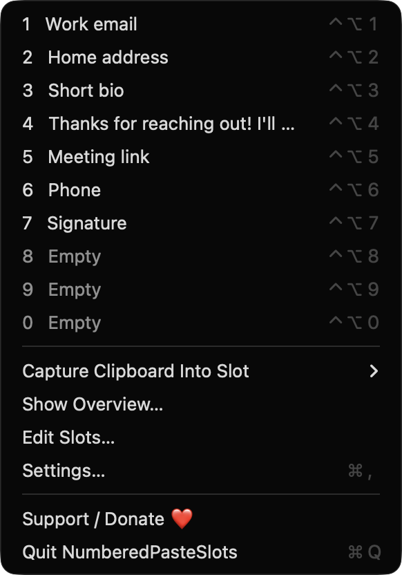
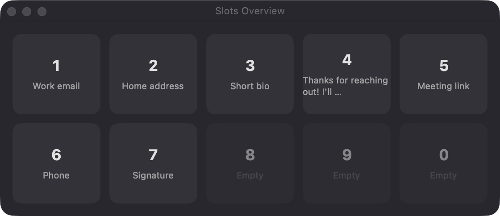
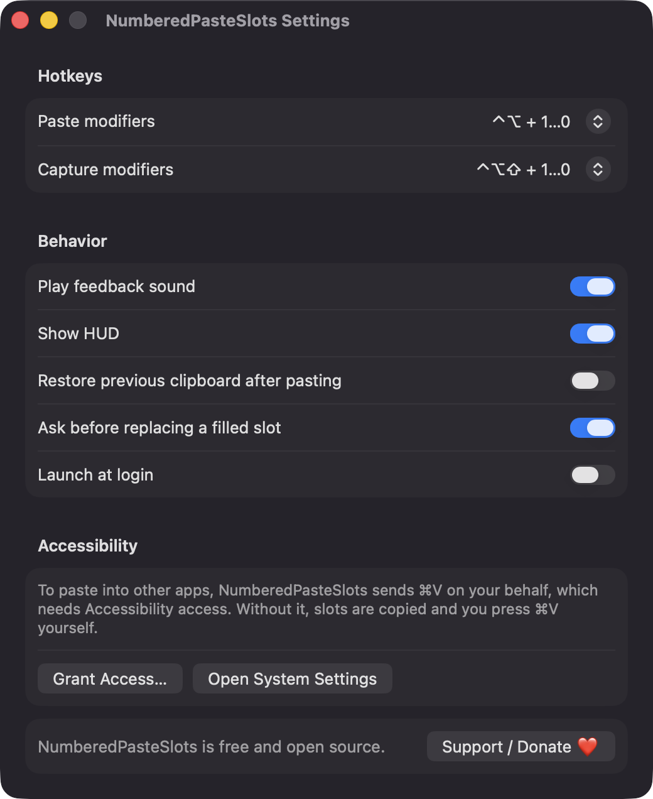

# NumberedPasteSlots

**🌐 Website:** [turhe123.github.io/numbered-paste-slots](https://turhe123.github.io/numbered-paste-slots/)

**Ten permanent paste slots you fill once and fire anywhere with a hotkey plus a number.**

> 🆓 A free, open-source **CleanClip alternative** for macOS 14+. Native Swift, no accounts, no subscriptions, MIT licensed.


## Why

Most clipboard tools are built around history. But a lot of what we paste never changes: an email address, a mailing address, a short bio, a license key. NumberedPasteSlots skips the history list and gives you ten fixed slots, numbered 1 through 0, that you fill once and reach with a hotkey. It is a free, open-source, 100% native, backend-free alternative to paid utilities in the *Clipboard* category, inspired by CleanClip ($12.99 one-time). Nothing leaves your Mac: no accounts, no servers, no analytics.

## Features

- **Ten fixed slots** (1–9 and 0), each holding text or an image, with an optional label.
- **Global paste hotkey:** ⌃⌥ + digit by default pastes the slot into the frontmost app.
- **Global capture hotkey:** ⌃⌥⇧ + digit by default saves whatever is on the clipboard into that slot (text preferred, falling back to PNG/TIFF images).
- **Configurable modifiers:** choose from nine modifier presets for each hotkey. The app blocks identical paste/capture modifiers and warns about known macOS screenshot shortcuts and hotkeys already taken by another app.
- **Layout-independent:** hotkeys use digit-row key codes, not characters.
- **Menu bar app** (no Dock icon): click a slot to paste it, or use the "Capture Clipboard Into Slot" submenu.
- **Edit Slots window:** label, multi-line text editor or image well, plain-text toggle, copy and clear buttons, and "Choose image…".
- **Drag and drop:** swap slots by dragging a row's digit badge onto another row; drop image files or image data onto an image slot.
- **Plain text only** option per slot drops captured rich-text formatting.
- **Overview panel:** a floating grid of all ten slots; click one to paste it into the app you were using.
- **Optional clipboard restore** after pasting, off by default.
- **Feedback:** optional HUD and sound ("Saved to slot 3", "Pasted slot 3").
- **Safe by default:** asks before replacing a filled slot (can be turned off), text capped at 100 KB, images at 5 MB, and a corrupt `slots.json` is backed up and reset.
- **Persistent:** text and metadata in JSON, images as PNG files, both in `~/Library/Application Support/NumberedPasteSlots`.
- **Launch at login** via `SMAppService`.

## Screenshots

<p align="center"></p>

<p align="center"><em>The menu bar menu lists all ten numbered slots with their ⌃⌥ + digit paste hotkeys, plus capture, overview, editing and settings.</em></p>

<p align="center"></p>

<p align="center"><em>The floating Slots Overview shows every slot in a grid click one to paste it into the app you were using.</em></p>

<p align="center"></p>

<p align="center"><em>The Edit Slots window lets you label each slot, edit its text, toggle plain-text only, and copy, clear or set an image.</em></p>

<p align="center"></p>

<p align="center"><em>Settings let you pick paste and capture modifiers, tune feedback and clipboard behavior, and grant Accessibility access.</em></p>

## Install

1. Download `NumberedPasteSlots-macOS.zip` from the [latest release](https://github.com/turhe123/numbered-paste-slots/releases/latest).
2. Unzip it and move `NumberedPasteSlots.app` to `/Applications`.
3. The app is open source and not notarized, so remove the quarantine flag:

   ```bash
   xattr -cr /Applications/NumberedPasteSlots.app
   ```

4. The first time, right-click the app and choose **Open**.

## Build from source

Requires macOS 14+ and Xcode with Swift 5.9+.

```bash
brew install xcodegen
xcodegen generate
xcodebuild -project NumberedPasteSlots.xcodeproj -scheme NumberedPasteSlots -configuration Release -derivedDataPath ./build build
```

The app is produced at `build/Build/Products/Release/NumberedPasteSlots.app`.

## Permissions

- **Accessibility** (the only permission requested): needed to send ⌘V to the frontmost app after a slot is placed on the clipboard. Grant it from Settings → Accessibility, or System Settings → Privacy & Security → Accessibility. Without it, the slot is still copied and the HUD tells you to press ⌘V yourself.
- **Screen Recording, Microphone, Camera, Contacts and similar:** not requested. The app does not use them.
- **Login item:** only if you turn on "Launch at login".

## Built with AI

NumberedPasteSlots was written by [Claude Code](https://claude.com/claude-code) inside an automated pipeline, from a plain-English spec. No code, binaries or assets from any commercial app were used; it is a clean-room reimplementation of a feature set, not a copy.

What that means in practice:

- The full source is in this repo under the MIT license. Read it before you run it.
- No network calls, no analytics, no third-party dependencies. Only Apple frameworks.
- Ad-hoc signed and not notarized, which is why Gatekeeper warns on first launch.
- It has had less human review than a hand-written app. Bug reports and pull requests are welcome.

## Support ❤️

NumberedPasteSlots is free and always will be. If it saves you time, you can support its development:

[Support Or (Leo) Davidai ❤️](https://ko-fi.com/leodavidai)

## More free Mac apps

NumberedPasteSlots is one of a growing collection of [free, open-source Mac utilities](https://github.com/turhe123/mac-apps) built the same way: native Swift, no accounts, no telemetry. Browse the full gallery at [turhe123.github.io/mac-apps](https://turhe123.github.io/mac-apps/).

Prefer something that runs in the browser? The same pipeline builds [free, private web tools](https://turhe123.github.io/web-tools/): PDF, image, developer, data and audio tools, nothing uploaded.

## License

MIT © Or Davidai Bachar
